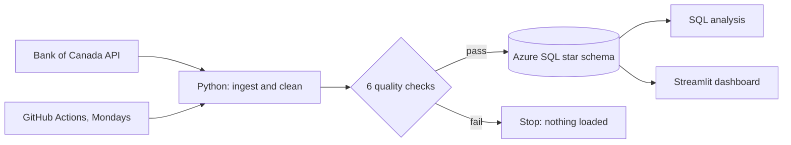
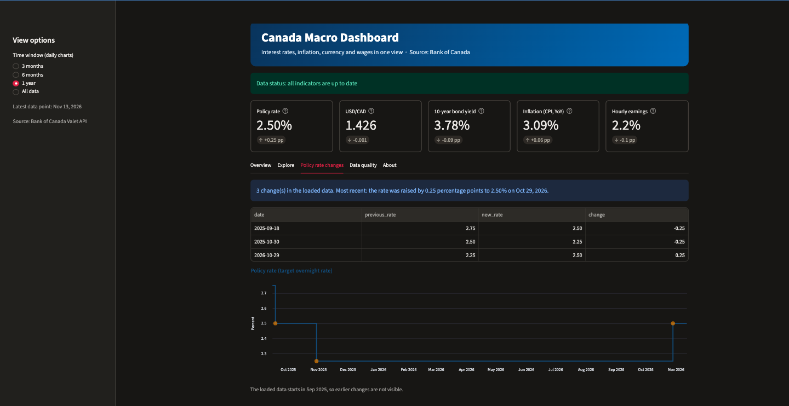
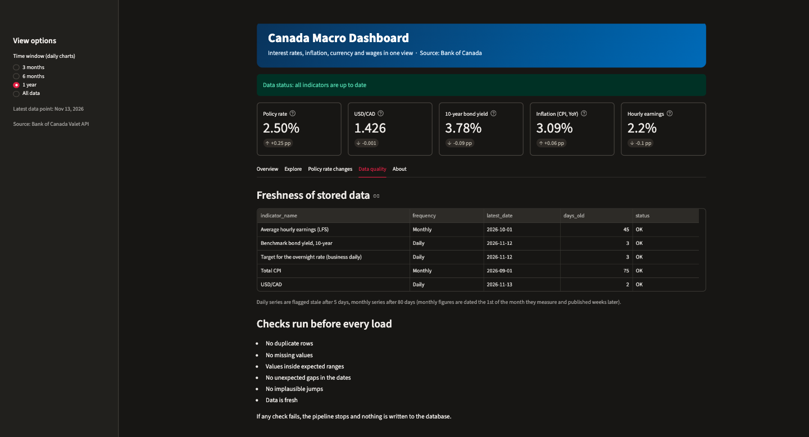
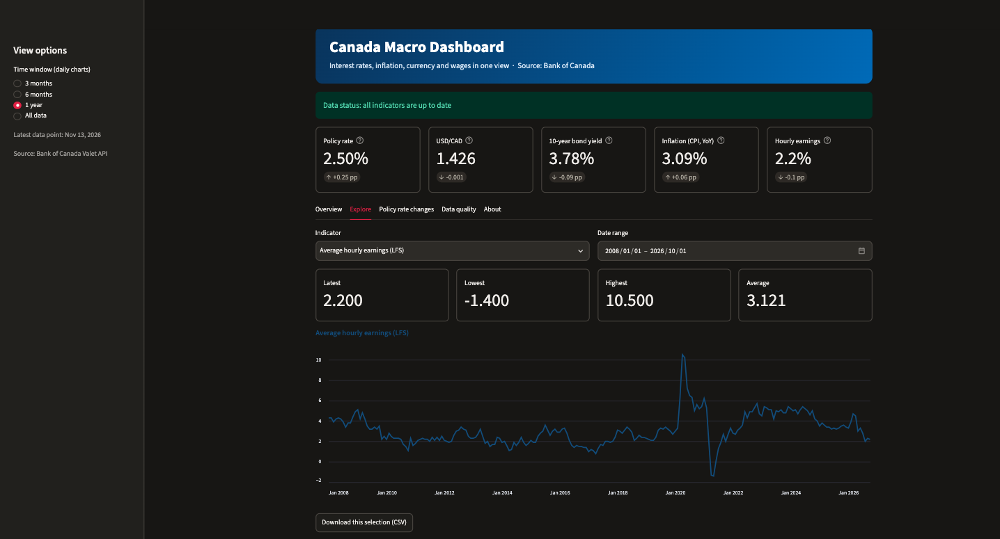

# Canada Macro Pipeline

An automated data pipeline that collects Canadian economic indicators from the Bank of Canada, checks their quality, stores them in an Azure SQL star schema, and presents them in an interactive dashboard.


## The problem

Interest rates, inflation, exchange rates, bond yields and wages are published separately, at different frequencies. An analyst who wants one trustworthy, up-to-date view has to collect and reconcile them by hand, which is slow and easy to get wrong.

This project does that work automatically and flags data that looks wrong before it reaches the database.

The business requirements and user stories behind it are in [docs/requirements.md](docs/requirements.md).

## What it does

1. **Ingest:** pulls five Bank of Canada series from the public Valet API.
2. **Clean and check:** standardizes the data and runs six automated quality checks. If any check fails, the pipeline stops and nothing is loaded.
3. **Load:** writes the data to an Azure SQL Database as a star schema.
4. **Analyze:** SQL queries and a Streamlit dashboard read from that database.
5. **Schedule:** a GitHub Actions workflow runs the whole pipeline every Monday.



## Indicators

| Indicator | Series ID | Frequency |
|---|---|---|
| Target for the overnight rate (policy rate) | `V39079` | Daily |
| USD/CAD exchange rate | `FXUSDCAD` | Daily |
| Total CPI | `V41690973` | Monthly |
| Government of Canada 10-year bond yield | `BD.CDN.10YR.DQ.YLD` | Daily |
| Average hourly earnings (LFS), shown in percent as labelled by the source | `STATIC_ATABLE_V35014A` | Monthly |

## Findings

These come from the loaded data as of November 2026 (the daily series cover roughly the latest 300 business days). They describe what happened, not why.

- **Policy rate:** three changes in the window. Cut from 2.75% to 2.50% on 2025-09-18, cut to 2.25% on 2025-10-30, then raised to 2.50% on 2026-10-29. It held at 2.25% for almost a year in between.
- **Inflation (CPI, year over year):** about 1.7 to 1.9% in mid-2025, a low of 1.78% in February 2026, a peak of 3.23% in May 2026, and 3.09% in September 2026.
- **USD/CAD:** ranged from 1.3515 to 1.4271, averaging 1.3893. The five highest days were all in early to mid October 2026 (peak 1.4271 on 2026-10-09). There was no meaningful weekday pattern (weekday averages differed by about 0.002), but the quarterly average rose from 1.3717 in Q1 2026 to 1.4113 in Q4 2026 (a partial quarter).
- **Hourly earnings growth:** peaked at 4.7% in March 2026 and eased to about 2% by late summer, while inflation stayed near 3%.



## Data model

A star schema with one fact table and three dimension tables.

| Table | Type | Contents |
|---|---|---|
| `fact_indicator` | Fact | One row per date and indicator, with the value |
| `dim_date` | Dimension | Year, quarter, month, month name, weekday |
| `dim_indicator` | Dimension | Indicator code, name, frequency, source |
| `dim_source` | Dimension | Data source |

The schema is in [sql/schema.sql](sql/schema.sql). Primary and foreign keys prevent duplicate rows and orphaned facts.

## SQL analysis

[sql/queries.sql](sql/queries.sql) holds eight queries, each tied to a user story. They use joins, subqueries, `GROUP BY`, CTEs, window functions (`LAG`) and `CASE` pivots. For example, finding every date the policy rate changed:

```sql
WITH rate AS (
    SELECT d.full_date, f.value,
           LAG(f.value) OVER (ORDER BY d.full_date) AS prev_value
    FROM fact_indicator f
    JOIN dim_date d ON f.date_key = d.date_key
    WHERE f.indicator_code = 'V39079'
)
SELECT full_date, prev_value, value AS new_value, value - prev_value AS change
FROM rate
WHERE prev_value IS NOT NULL AND value <> prev_value
ORDER BY full_date;
```

## Data quality

Six checks run before every load:

- No duplicate rows
- No missing values
- Values inside expected ranges
- No unexpected gaps (limits differ for daily and monthly series)
- No implausible jumps
- Data is fresh (limits differ for daily and monthly series)

If any check fails, the pipeline stops and the database is left untouched. The load itself is a single transaction, so a failure part-way through rolls back to the previous data. The checks have pytest tests in `tests/`, and a SQL freshness query monitors the stored data.



## Dashboard

A Streamlit app with KPI cards, charts with a time-window selector, an indicator explorer with CSV download, a policy-rate change table, and a data-quality tab.



## Automation

The workflow in [.github/workflows/weekly_pipeline.yml](.github/workflows/weekly_pipeline.yml) is scheduled for Mondays at 12:00 UTC and can also be run by hand from the Actions tab. It installs the ODBC driver and Python packages, then runs `src/run_pipeline.py`. Credentials come from GitHub Secrets, never from the code. A failed quality check or load fails the run, and GitHub emails the repository owner.

## Project structure

```
canada-macro-pipeline/
├── .github/workflows/   weekly pipeline run
├── docs/                requirements, user stories, screenshots
├── sql/                 schema.sql, queries.sql
├── src/                 ingest, clean, checks, load, run_pipeline, dashboard
├── tests/               pytest tests for the quality checks
├── .env.example         the settings the project needs
└── requirements.txt
```

## Running it yourself

You need Python 3.12 or newer, an Azure SQL Database (the free offer works), and the Microsoft ODBC Driver 18 for SQL Server.

```bash
git clone https://github.com/micky7madrid/canada-macro-pipeline.git
cd canada-macro-pipeline
python3 -m venv venv
source venv/bin/activate
pip install -r requirements.txt

cp .env.example .env
# fill in your Azure SQL server, database, user and password in .env

python3 src/create_schema.py     # create the tables
python3 src/run_pipeline.py      # fetch, check, load
streamlit run src/dashboard.py   # open the dashboard
pytest                           # run the tests
```

Azure SQL only accepts connections from allowed IP addresses, so add your own address to the server's firewall rules first. The free database pauses when idle, so the first connection can take a minute.

## Tech stack

Python, pandas, requests, pyodbc, pytest, SQL (Azure SQL Database / T-SQL), Streamlit, Altair, Git and GitHub Actions.

## Limitations and next steps

- Five indicators from one source. Unemployment and housing prices are not included because they need a Statistics Canada source.
- Each run reloads the latest observations (about 300 per series) and replaces the tables, so history does not accumulate over time. An incremental load would fix this.
- The dashboard runs locally and is not publicly hosted.
- The scheduled run uses the Azure setting that allows Azure services to reach the server, a convenient but less strict firewall choice. That is acceptable for public economic data, but not for sensitive data.
- The free database tier pauses when idle and has no uptime guarantee.

## Author

Mikael Syed | [LinkedIn](https://linkedin.com/in/mikaelsyed) | [Portfolio](https://mikael-syed-portfolio.vercel.app)
